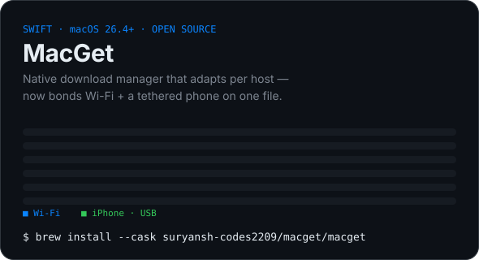
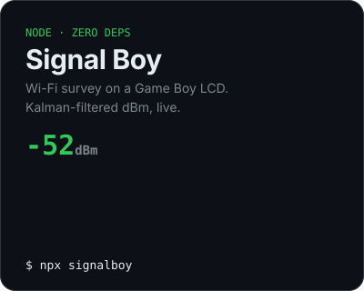
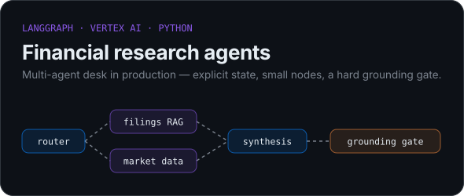
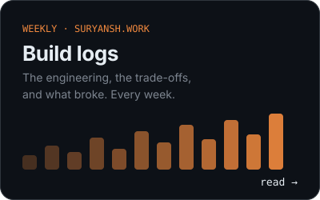

<a href="https://suryansh.work">
  <picture>
    <source media="(prefers-color-scheme: dark)" srcset="./assets/hero-dark.svg">
    <source media="(prefers-color-scheme: light)" srcset="./assets/hero-light.svg">
    
  </picture>
</a>

  <a href="https://suryansh.work">suryansh.work</a> ·
  <a href="https://suryansh.work/blog">Build logs</a> ·
  <a href="https://x.com/suryanshbuilds">X</a> ·
  <a href="https://www.linkedin.com/in/suryansh-chaudhary-2209/">LinkedIn</a> ·
  <a href="https://suryansh.work/suryansh.pdf">Résumé</a>

<a href="https://github.com/Suryansh-Codes2209/Macget"><picture><source media="(prefers-color-scheme: dark)" srcset="./assets/macget-dark.svg"><source media="(prefers-color-scheme: light)" srcset="./assets/macget-light.svg"></picture></a><a href="https://github.com/Suryansh-Codes2209/Signal-Boy"><picture><source media="(prefers-color-scheme: dark)" srcset="./assets/signalboy-dark.svg"><source media="(prefers-color-scheme: light)" srcset="./assets/signalboy-light.svg"></picture></a>
<a href="https://suryansh.work/blog/how-we-architect-a-financial-ai-analyst-multi-agent"><picture><source media="(prefers-color-scheme: dark)" srcset="./assets/agents-dark.svg"><source media="(prefers-color-scheme: light)" srcset="./assets/agents-light.svg"></picture></a><a href="https://suryansh.work/blog"><picture><source media="(prefers-color-scheme: dark)" srcset="./assets/logs-dark.svg"><source media="(prefers-color-scheme: light)" srcset="./assets/logs-light.svg"></picture></a>

### Fresh from the build log

<!-- BLOG-POST-LIST:START -->- [Signal Boy: a zero-dependency WiFi survey tool you run with npx](https://suryansh.work/blog/signal-boy-npx-wifi-survey-tool-zero-dependencies) — Aug 7, 2026 - [MCP servers vs agent skills: the payload is the integration](https://suryansh.work/blog/mcp-servers-vs-agent-skills-tool-payload-design) — Aug 3, 2026 - [MacGet 1.3.0: BitTorrent, book catalogs, and deleting my own adaptive concurrency](https://suryansh.work/blog/macget-1-3-0-bittorrent-book-catalogs-adaptive-concurrency) — Jul 30, 2026 - [Automating blog cover art with Gemini 3 Pro Image: my &#39;no legible text&#39; rule was the bug](https://suryansh.work/blog/automating-blog-cover-art-gemini-3-pro-image) — Jul 26, 2026 <!-- BLOG-POST-LIST:END -->

### Works with

`LangGraph` `Python` `FastAPI` `TypeScript` `React` `Next.js` `Swift` `SwiftUI` `Vertex AI` `Claude & Gemini APIs` `Cloud Run` `Postgres`

### Say hi

Open to collaborations on agent infrastructure and developer tooling, and always happy to talk LangGraph, RAG evals, or Swift concurrency → **suryansh.codes2001@gmail.com**
